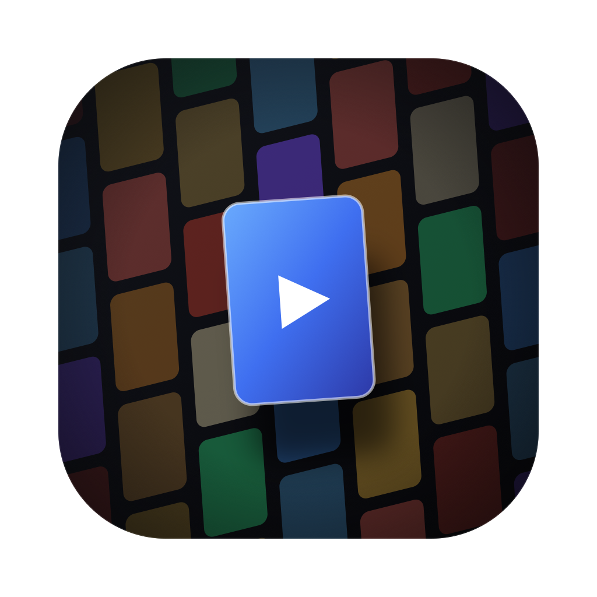
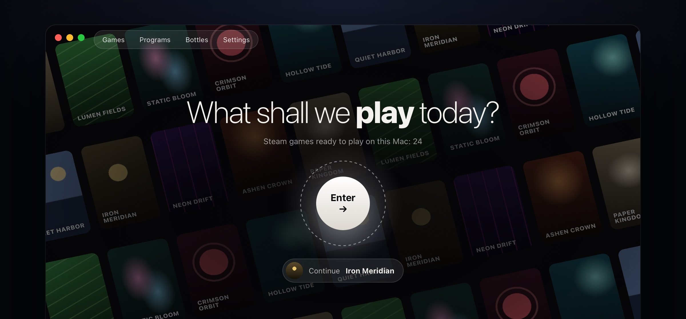
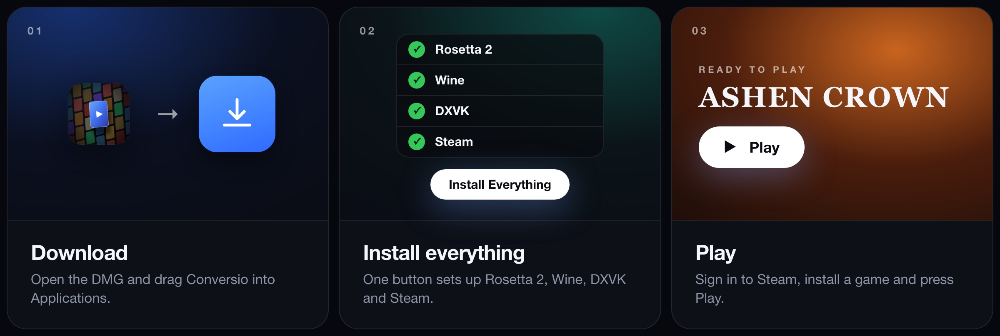
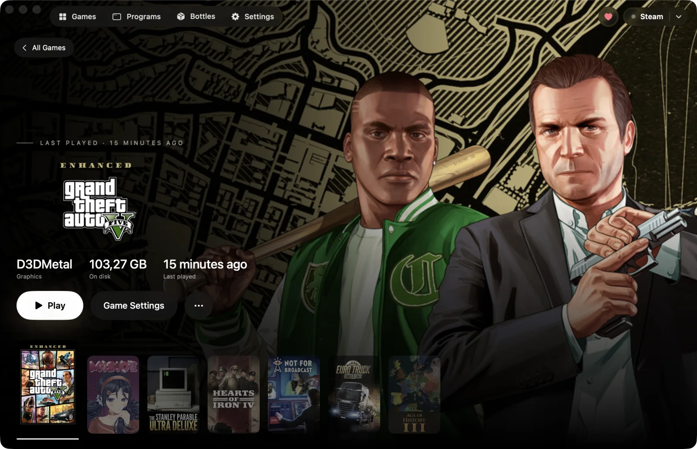
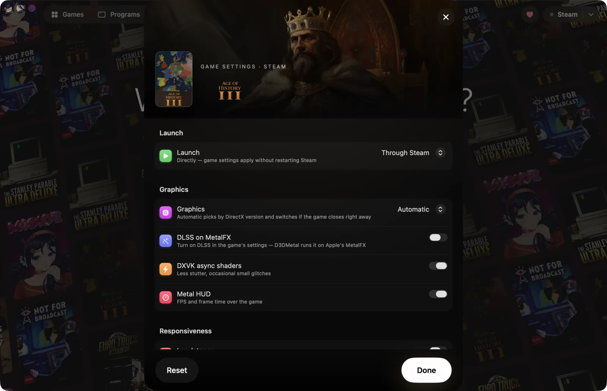
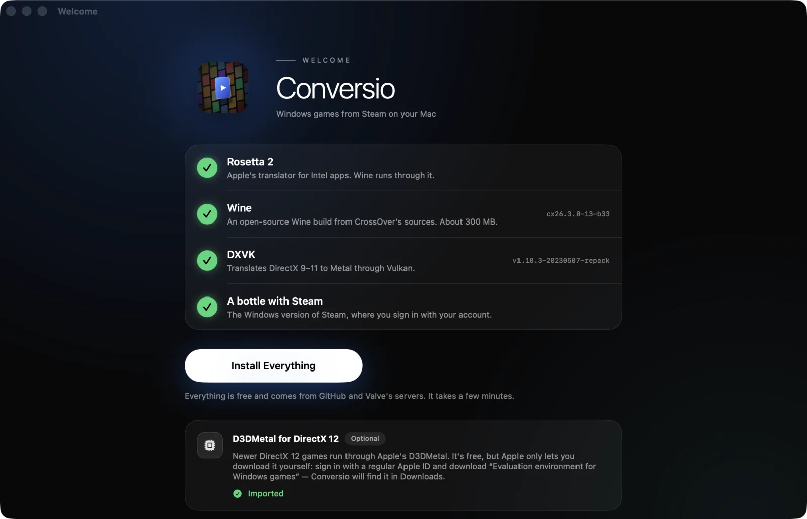
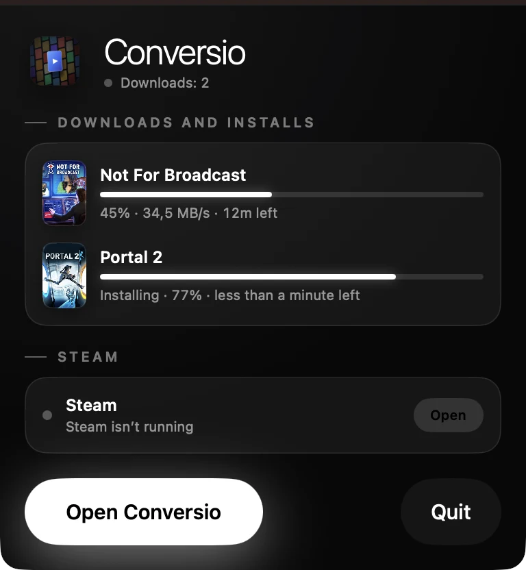
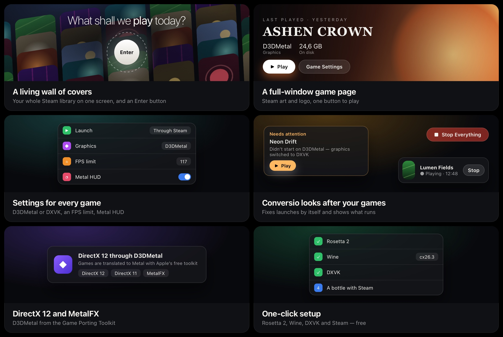
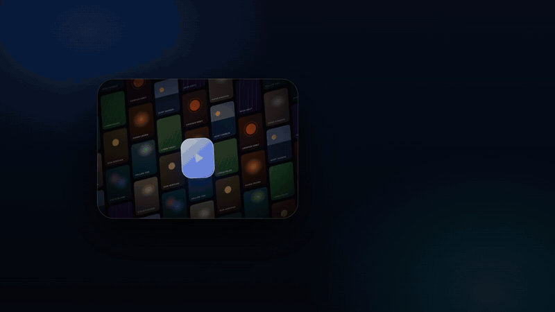
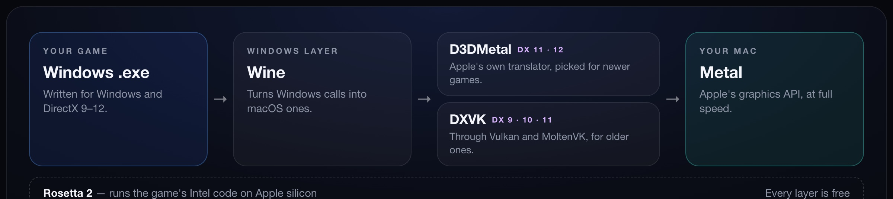

  

<h1 align="center">Conversio</h1>

  <b>Windows games from Steam on your Mac</b> 
  Free. No Windows, no virtual machine, no subscription · by <a href="https://github.com/theoron-apps">Theoron</a>

  
  
  
  
  

  

  English · <a href="README.ru.md">Русский</a> · <a href="README.uk.md">Українська</a>

  

  <a href="#quick-start">Quick start</a> ·
  <a href="#a-look-inside">A look inside</a> ·
  <a href="#features">Features</a> ·
  <a href="#how-it-works">How it works</a> ·
  <a href="#games">Games</a> ·
  <a href="#questions">Questions</a> ·
  <a href="#guides">Guides</a>

---

Conversio runs the Windows version of Steam and your Windows games on a Mac with Apple silicon — like CrossOver, but **free**. It sets everything up with one button, keeps your games on a wall of Steam covers, picks the right graphics for every game and lets you tune each one separately.

## Quick start

  

1. **Download** `Conversio-<version>.dmg` from [Releases](../../releases/latest), open it and drag **Conversio** into **Applications**.
2. **Open Conversio and click Install Everything.** It installs Rosetta 2 (macOS asks for your password), downloads Wine (about 300 MB) and DXVK, creates a bottle and puts Steam into it.
3. **Sign in to Steam, install a game and press Play.** The game shows up in Conversio as soon as Steam finishes downloading it.

You need a Mac with Apple silicon (M1 or later), macOS 15 Sequoia or later, and about 2 GB of free space plus room for your games.

> [!IMPORTANT]
> **The first time you open it,** macOS says it can't verify the developer: Conversio isn't signed with a paid Apple Developer ID yet. Click **Done**, open **System Settings → Privacy & Security**, scroll down to **Security** and click **Open Anyway**. You do this once.

> [!TIP]
> One command in Terminal does the same: `xattr -dr com.apple.quarantine /Applications/Conversio.app`

## A look inside

<table>
  <tr>
    <td width="50%" valign="top">
       
      <b>A page for every game</b> 
      Steam art, the graphics it runs on, size on disk and one Play button.
    </td>
    <td width="50%" valign="top">
       
      <b>Settings for every game</b> 
      Launch mode, graphics, an FPS limit and Metal HUD — without touching other games.
    </td>
  </tr>
  <tr>
    <td width="50%" valign="top">
       
      <b>One-click setup</b> 
      Everything the games need, downloaded and installed for you.
    </td>
    <td width="50%" valign="top" align="center">
       
      <b>Downloads in the menu bar</b> 
      Speed, time left and running games, without opening the window.
    </td>
  </tr>
</table>

## Features

  

- **One-click setup** — Rosetta 2, Wine, DXVK and Steam for Windows, downloaded and installed for you.
- **Your Steam library** — installed games appear by themselves, with Steam covers, search and recently played games.
- **Automatic graphics** — Conversio picks D3DMetal or DXVK for each game. If a game fails to start, it retries with the other one and remembers what worked.
- **Settings for every game** — graphics, Metal HUD with FPS, an FPS limit, low latency, launch arguments and environment variables.
- **Game profiles** — GTA V Enhanced and Legacy, Euro Truck Simulator 2, American Truck Simulator, Hearts of Iron IV and Dota 2 set themselves up the first time they appear.
- **DirectX 12** — import D3DMetal from Apple's free Game Porting Toolkit, and DirectX 11 and 12 games run on Metal.
- **Looks after your game** — warns when screen recording or low memory slows a game down, keeps the Mac awake while you play or download, and shows downloads in the menu bar.
- **Bottles and other programs** — separate Windows installations, like in CrossOver; run any `.exe`, `.msi` or `.bat`, not only Steam games.

In English, Ukrainian and Russian.

  

## How it works

Windows games don't run on macOS by themselves. Conversio puts a few free layers in between:

  

| Layer | What it does | Where it comes from |
|---|---|---|
| **Wine** | Runs Windows programs: translates Windows calls into macOS ones | Our own builds of CrossOver's open-source Wine: [conversio-wine](https://github.com/theoron-apps/conversio-wine) |
| **DXVK** | Translates DirectX 9–11 into Vulkan, and MoltenVK turns it into Metal | [DXVK-macOS](https://github.com/Gcenx/DXVK-macOS) |
| **D3DMetal** *(optional)* | Apple's own translation of DirectX 11 and 12 into Metal | Apple's free [Game Porting Toolkit](https://developer.apple.com/games/game-porting-toolkit/) |
| **Rosetta 2** | Runs Intel code on Apple silicon | Built into macOS |

Nothing has to be bought. Wine and DXVK are downloaded automatically. D3DMetal is free too, but Apple doesn't allow other apps to ship it, so you download it yourself with a regular Apple ID — [the guide](docs/guides/d3dmetal.md) takes two minutes.

## Games

Whether a game works depends on the game:

- **Usually work:** most DirectX 9–12 single-player games and many indie games.
- **Often don't work:** games with kernel-level anti-cheat (some EasyAntiCheat, BattlEye, Vanguard, Ricochet setups), and games that need AVX2 instructions Rosetta 2 can't translate on older macOS versions.

Checked on a MacBook Pro with M5 Pro, macOS 26:

| Game | Status | Notes |
|---|---|---|
| GTA V Enhanced | ✅ Works | Story mode, 85–120 FPS at 1728×1117. Needs D3DMetal from Game Porting Toolkit 4.0 beta 3 or later — [guide and settings](docs/guides/gta-v-enhanced.md) |
| GTA V Legacy | ✅ Works | Story mode, borderless window |
| Euro Truck Simulator 2 | ✅ Works | D3DMetal |
| The Stanley Parable: Ultra Deluxe | ✅ Works | D3DMetal |
| R.E.P.O. | ✅ Works | D3DMetal |
| Age of History 3 | ✅ Works | |
| Dota 2 | ✅ Works | Audio set up by the game profile |
| Not For Broadcast | ✅ Works | Use the borderless window: exclusive fullscreen is cropped |
| City Car Driving | ✅ Works | 32-bit, DXVK is chosen automatically |
| Hearts of Iron IV | ⚠️ Works without the launcher | The Paradox Launcher stays blank, so Conversio starts the game directly |

Found a game that works or doesn't? [Open a game report](../../issues/new/choose) — it helps everyone.

## Questions

<b>Is it really free?</b>

 
Yes. Conversio, Wine and DXVK are free, and so is Apple's D3DMetal — you only need a regular Apple ID to download it. You play the games you already own on Steam.

<b>Do I need Windows or a virtual machine?</b>

 
No. Games run as ordinary Mac processes: Wine translates Windows calls and D3DMetal or DXVK translate DirectX into Metal. There is no Windows license and no second system to keep running.

<b>How is it different from CrossOver?</b>

 
CrossOver is a paid product with official support and a much wider range of Windows software. Conversio is free and focused on one thing — Steam games — and uses Wine built from CrossOver's open-source code.

<b>Does multiplayer work?</b>

 
Where the game's anti-cheat allows it. Dota 2 works; GTA Online doesn't, because BattlEye needs a Windows kernel driver. Games with kernel-level anti-cheat usually don't start at all.

<b>Is my Steam account safe?</b>

 
You sign in inside the genuine Windows Steam client. Conversio never sees your password and has no servers of its own — see <a href="#privacy">Privacy</a>.

<b>Why does macOS warn me on the first launch?</b>

 
The app isn't signed with a paid Apple Developer ID yet, so macOS asks you to confirm the first launch once. The steps are in <a href="#quick-start">Quick start</a>.

<b>Does it work on an Intel Mac?</b>

 
No. Conversio needs Apple silicon (M1 or later) and macOS 15 or later.

<b>Can I run programs that aren't on Steam?</b>

 
Yes. Open any <code>.exe</code>, <code>.msi</code> or <code>.bat</code> with Conversio, or add a program to the library from a bottle's page.

<b>A game doesn't start. What now?</b>

 
Right-click its cover and choose <b>Why Won't It Start?…</b> — Conversio shows what it found. Then try the other graphics (D3DMetal ↔ DXVK) or the other launch mode. More in the <a href="docs/guides/troubleshooting.md">troubleshooting guide</a>.

## Guides

Step by step, in English and Russian:

- **[Install](docs/guides/install.md)** — from the DMG to the first game
- **[D3DMetal for DirectX 12](docs/guides/d3dmetal.md)** — where to download it and how to import it
- **[GTA V Enhanced](docs/guides/gta-v-enhanced.md)** — first launch and tested graphics settings
- **[Troubleshooting](docs/guides/troubleshooting.md)** — when a game doesn't start or runs slowly

## Reference

<b>Launch modes</b>

 

Every game can start in one of two ways — pick it in **Game Settings** (right-click a cover):

| Launch mode | How it works | When to use |
|---|---|---|
| **Through Steam** *(default)* | Conversio asks Steam to start the game, just like on Windows | Most games, especially ones with launchers or DRM |
| **Directly** | Steam stays in the background, Conversio starts the game's `.exe` itself | When you want game settings to apply without restarting Steam |

Games started through Steam inherit Steam's settings. If a game has its own settings and Steam is already running with different ones, Conversio offers to restart Steam.

<b>Game settings</b>

 

| Setting | What it does |
|---|---|
| Graphics | **Automatic**, **D3DMetal** (when imported) for DirectX 11/12, **DXVK** for DirectX 9–11, or the bottle's default |
| DLSS on MetalFX | Apple's upscaling for games that support DLSS — D3DMetal only |
| DXVK async shaders | Less stutter while shaders compile |
| Metal HUD | FPS, frame time and GPU over the game |
| Low latency | One frame in flight and no VSync — DXVK only |
| FPS limit | 30, 60, 90, 117 or 120 — works with D3DMetal and DXVK |
| Launch arguments | For example `-dx11` or `-windowed` |
| Environment variables | `KEY=value`, one per line |

Synchronization (**MSync**) and Retina mode are set for the whole bottle, on the bottle's page.

<b>DirectX 12 with D3DMetal</b>

 

1. Open [Apple's downloads page](https://developer.apple.com/download/all/?q=game%20porting%20toolkit) and sign in with your Apple ID (a free account is enough).
2. Download **Evaluation environment for Windows games** — the newest version, **4.0 beta 3 or later**. DirectX 12 games such as GTA V Enhanced need it.
3. Conversio finds the DMG in Downloads: click **Import** on the welcome screen or in **Settings → Engine**.

After that, **D3DMetal** becomes the default graphics for all bottles. You can remove it at any time in the same place. The [full guide](docs/guides/d3dmetal.md) covers what to do when the import fails.

<b>Bottles</b>

 

A bottle is a separate Windows: its own drive C:, registry, installed programs and settings. One bottle with Steam is enough for most people. Make another one (**File → New Bottle…**) when a game needs a different Windows version or settings that break other games.

On the bottle page you can open Steam, run any Windows installer or program, add a program to the library, open drive C: in Finder, open Wine settings, the registry or the task manager, and stop everything that runs in the bottle.

<b>Updates</b>

 

Conversio checks for a new version every time it launches and every six hours. When one is out, it offers to **Download** it, remind you **Later** or **Skip** that version. Open the new DMG and replace the app in Applications — your bottles, games and settings are kept, and Conversio shows what's new.

You can turn the checks off or check manually in **Settings → About → Updates**. The engine is updated separately in **Settings → Engine**.

<b>Where things are</b>

 

| What | Where |
|---|---|
| Engine (Wine, DXVK, D3DMetal) | `~/Library/Application Support/Conversio/Engine` |
| Bottles with games and saves | `~/Library/Application Support/Conversio/Bottles` |
| Logs | `~/Library/Logs/Conversio` |
| Covers | `~/Library/Caches/Conversio` |

<b>Uninstall</b>

 

Quit Conversio, delete it from Applications and, if you want to remove games and saves too, delete `~/Library/Application Support/Conversio`.

## What's next

- A newer Wine built from CrossOver 27 sources, with better DirectX 12 support, once they are public.
- Retina mode for a single game instead of the whole bottle.
- macOS Game Mode for Windows games.
- More game profiles — [game reports](../../issues/new/choose) decide which ones come first.

## Privacy

- Conversio collects no analytics.
- Network access is limited to downloading the engine from GitHub, the Steam installer and game covers from Valve's servers, and the update check against this GitHub repository, which sends nothing about you.
- Your Steam account is only ever entered into Steam itself.

## License and thanks

Conversio is free to download and use. The app's source code is not public; the Wine builds it uses are open source under the LGPL in [conversio-wine](https://github.com/theoron-apps/conversio-wine). © 2026 Theoron.

Conversio stands on the shoulders of [Wine](https://www.winehq.org) (LGPL), [DXVK](https://github.com/doitsujin/dxvk) (zlib), [MoltenVK](https://github.com/KhronosGroup/MoltenVK) (Apache 2.0), the macOS builds by [Gcenx](https://github.com/Gcenx), and Apple's Game Porting Toolkit. Steam is a trademark of Valve Corporation. Conversio is not affiliated with Valve, Apple, Microsoft or CodeWeavers. The games on the illustrations and in the animation are made up; game art on the screenshots belongs to its publishers.

---

  Conversio is free. If it helped you, you can <a href="https://send.monobank.ua/jar/2jGp4yDQPd"><b>support development</b></a> with any Visa or Mastercard, Apple Pay or Google Pay.

  News and support — Telegram <a href="https://t.me/TheoronApps">@TheoronApps</a> · <a href="mailto:theoronapps@gmail.com">theoronapps@gmail.com</a>

