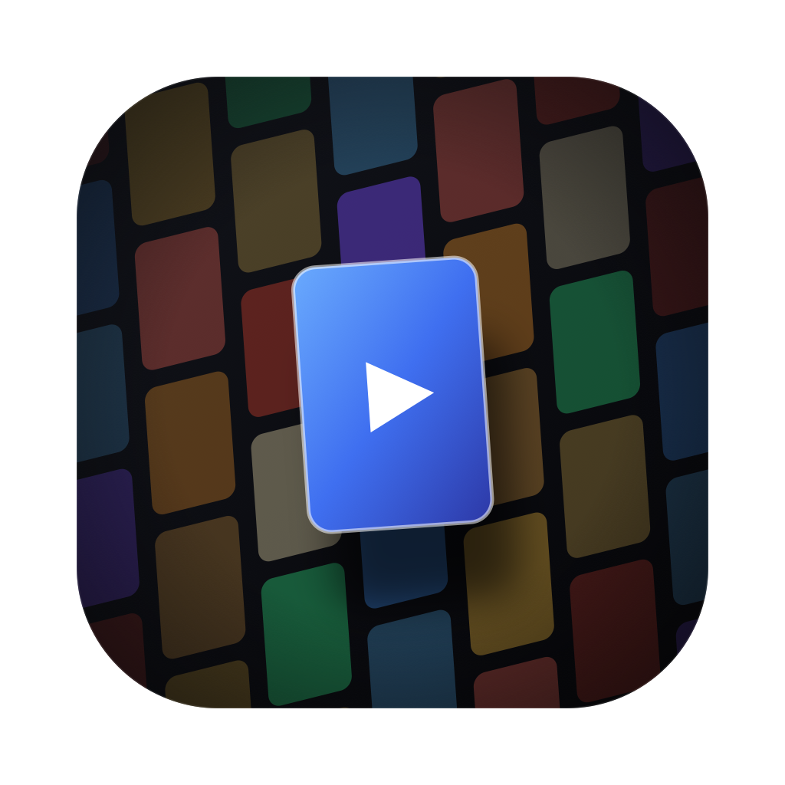
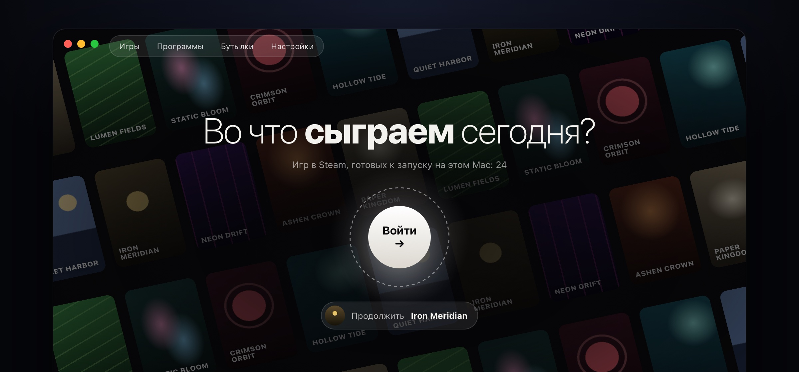
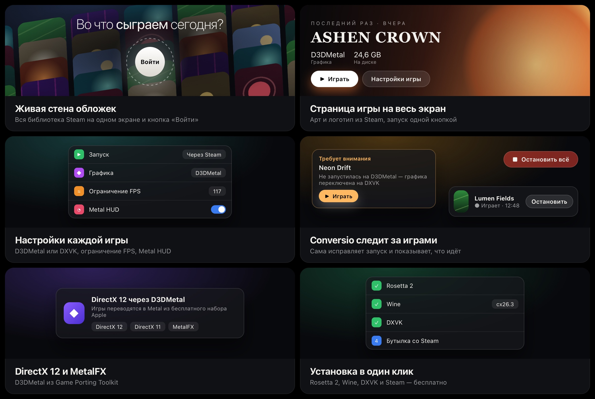

  

<h1 align="center">Conversio</h1>

Windows-игры из Steam на вашем Mac · от <a href="https://github.com/theoron-apps">Theoron</a>

  
  
  
  
  

  <a href="../../releases/latest"><b>Скачать</b></a> ·
  <a href="README.md">English</a> · Русский · <a href="README.uk.md">Українська</a>

  

---

Conversio запускает Windows-версию Steam и ваши Windows-игры на Mac с Apple Silicon — как CrossOver, только **бесплатно**. Всё настраивается в один клик, игры собираются в библиотеку с обложками из Steam, а каждую игру можно настроить отдельно.

## Что умеет

  

- **Установка в один клик** — Rosetta 2, Wine, DXVK и Steam для Windows скачиваются и ставятся сами.
- **Библиотека Steam** — установленные игры появляются сами, с обложками из Steam, поиском и списком недавних. Двойной клик — и игра запускается.
- **Настройки каждой игры** — D3DMetal или DXVK, MSync, Metal HUD с FPS, апскейлинг MetalFX, ограничение FPS, аргументы запуска и переменные окружения.
- **Бутылки** — отдельные Windows, у каждой свой диск C:, реестр и настройки, как в CrossOver. Запуск любых `.exe`, `.msi` и `.bat`, свои программы в библиотеке, настройки Wine, реестр и диспетчер задач.
- **Автоматическая графика** — Conversio сама выбирает D3DMetal или DXVK (32-битные игры на DirectX 11 — через DXVK). Если игра не запустилась, пробует другой вариант и запоминает рабочий.
- **Профили игр** — известные игры настраиваются сами при первом появлении: GTA V Enhanced и Legacy, Euro Truck Simulator 2, American Truck Simulator, Hearts of Iron IV и Dota 2.
- **Rockstar Games Launcher** — GTA V запускается через Steam и лаунчер Rockstar со входом в аккаунт, как на Windows.
- **Минимальная задержка** — для игр на DXVK один кадр в очереди и без VSync; ограничение FPS для любой игры; полноэкранный режим в обход композитора macOS.
- **Следит за игрой** — предупреждает, когда запись экрана или нехватка памяти замедляют игру, не даёт Mac уснуть во время игры и загрузки, показывает запущенные игры и загрузки в строке меню.
- **DirectX 12** — импортируйте D3DMetal из бесплатного Game Porting Toolkit от Apple, и игры на DirectX 11 и 12 заработают на Metal.
- **Что нового** после каждого обновления и автоматическая проверка обновлений.
- Русский, украинский и английский языки.

## Как это работает

Сами по себе Windows-игры на macOS не запускаются. Conversio ставит между ними три бесплатных слоя:

| Слой | Что делает | Откуда берётся |
|---|---|---|
| **Wine** | Запускает Windows-программы: переводит вызовы Windows в вызовы macOS | Наши сборки открытого Wine из исходников CrossOver: [conversio-wine](https://github.com/theoron-apps/conversio-wine) |
| **DXVK** | Переводит DirectX 9–11 в Vulkan, а MoltenVK — в Metal | [DXVK-macOS](https://github.com/Gcenx/DXVK-macOS) |
| **D3DMetal** *(по желанию)* | Перевод DirectX 11 и 12 в Metal от самой Apple | Бесплатный [Game Porting Toolkit](https://developer.apple.com/games/game-porting-toolkit/) от Apple |
| **Rosetta 2** | Запускает код Intel на Apple Silicon | Встроена в macOS |

Ничего покупать не нужно. Wine и DXVK скачиваются автоматически. D3DMetal тоже бесплатный, но Apple не разрешает встраивать его в другие приложения, поэтому его нужно скачать самому с обычным Apple ID (см. ниже).

## Гайды

Пошагово: [установка](docs/guides/install.ru.md) · [D3DMetal для DirectX 12](docs/guides/d3dmetal.ru.md) · [GTA V Enhanced](docs/guides/gta-v-enhanced.ru.md) · [если игра не работает](docs/guides/troubleshooting.ru.md).

## Требования

- Mac с Apple Silicon (M1 или новее)
- macOS 15 Sequoia или новее
- Около 2 ГБ свободного места для движка и Steam, плюс место для игр
- Для кнопок Liquid Glass нужна macOS 26; на macOS 15 вместо них размытие

## Установка

1. Скачайте `Conversio-<версия>.dmg` из [Releases](../../releases/latest).
2. Откройте DMG и перетащите **Conversio** в **Программы**.
3. Откройте Conversio. macOS скажет, что не может проверить разработчика, — нажмите **Готово**.
4. Откройте **Системные настройки → Конфиденциальность и безопасность** и прокрутите вниз до раздела **Безопасность**.
5. Нажмите **Всё равно открыть** рядом с сообщением о Conversio и подтвердите паролем или Touch ID.
6. Запустите Conversio ещё раз — дальше приложение будет открываться как обычно.

Почему так: приложение пока не подписано платным Apple Developer ID, поэтому macOS один раз просит подтвердить первый запуск.

> Для продвинутых: вместо шагов 3–5 можно выполнить
> `xattr -dr com.apple.quarantine /Applications/Conversio.app`

## Первый запуск

1. Нажмите **Установить всё**. Conversio установит Rosetta 2 (macOS спросит пароль), скачает Wine (около 300 МБ) и DXVK, создаст бутылку и поставит в неё Steam.
2. Откроется Steam. Войдите в свой аккаунт.
3. Установите игру в Steam как обычно — когда она скачается, она появится в библиотеке Conversio.
4. Наведите курсор на обложку и нажмите **Играть**.

## Как запускаются игры

Каждую игру можно запускать одним из двух способов — выберите в **Настройках игры** (правый клик по обложке):

| Способ | Как работает | Когда подходит |
|---|---|---|
| **Через Steam** *(по умолчанию)* | Conversio просит Steam запустить игру, как на Windows | Большинство игр, особенно с лаунчерами и DRM |
| **Напрямую** | Steam работает в фоне, а `.exe` игры запускает сам Conversio | Когда нужно, чтобы настройки игры применялись без перезапуска Steam |

Игры, запущенные через Steam, наследуют настройки Steam. Если у игры свои настройки графики, а Steam уже запущен с другими, Conversio предложит перезапустить Steam.

### Настройки игры

| Настройка | Что делает |
|---|---|
| Графика | **D3DMetal** (если импортирован) для DirectX 11/12, **DXVK** для DirectX 9–11 или как в бутылке |
| MetalFX | Апскейлинг Apple для игр с поддержкой DLSS — только D3DMetal |
| Асинхронные шейдеры DXVK | Меньше подтормаживаний, пока компилируются шейдеры |
| Синхронизация | **MSync** (обычно быстрее всего) или выключено |
| Metal HUD | FPS, время кадра и загрузка GPU поверх игры |
| Аргументы запуска | Например, `-dx11` или `-windowed` |
| Переменные окружения | `КЛЮЧ=значение`, по одной на строку |

## DirectX 12 через D3DMetal

1. Откройте [developer.apple.com/games/game-porting-toolkit](https://developer.apple.com/games/game-porting-toolkit/) и войдите с Apple ID (хватит бесплатного аккаунта).
2. Скачайте **Game Porting Toolkit**.
3. В Conversio откройте **Настройки → Движок** и нажмите **Выбрать DMG…** рядом с D3DMetal. Выберите скачанный DMG — Conversio подключит его, скопирует D3DMetal в свой Wine и отключит образ.

Для игр на DirectX 12, например GTA V Enhanced, нужен Game Porting Toolkit **4.0 beta 3 или новее** — в старых версиях нет того, что нужно этим играм.

После этого **D3DMetal** станет графикой по умолчанию во всех бутылках. Удалить его можно там же.

## Бутылки

Бутылка — это отдельная Windows: свой диск C:, реестр, установленные программы и настройки. Большинству хватит одной бутылки со Steam. Создайте ещё одну (**Файл → Новая бутылка…**), если игре нужна другая версия Windows или настройки, которые ломают другие игры.

На странице бутылки можно открыть Steam, запустить любой установщик или программу Windows, добавить программу в библиотеку, открыть диск C: в Finder, открыть настройки Wine, реестр или диспетчер задач и остановить всё, что работает в бутылке.

## Совместимость

Заработает ли игра, зависит от самой игры:

- **Обычно работают:** большинство одиночных игр на DirectX 9–12 и многие инди-игры.
- **Часто не работают:** игры с античитом уровня ядра (некоторые варианты EasyAntiCheat, BattlEye, Vanguard, Ricochet) и игры, которым нужны инструкции AVX2, которые Rosetta 2 не переводит на старых macOS.
- Если игра не запускается, попробуйте другую графику (D3DMetal ↔ DXVK), выключите MSync или смените способ запуска. Включите **Настройки → Основные → Подробные журналы Wine** и загляните в **Справка → Журналы Wine**.

### Проверенные игры

Проверено на MacBook Pro с M5 Pro, macOS 26:

| Игра | Статус | Примечания |
|---|---|---|
| GTA V Enhanced | ✅ Работает | D3DMetal из Game Porting Toolkit 4.0 beta 3, сюжетный режим (онлайну нужен BattlEye, он не запускается) |
| GTA V Legacy | ✅ Работает | Сюжетный режим, окно без рамки |
| Euro Truck Simulator 2 | ✅ Работает | D3DMetal |
| The Stanley Parable: Ultra Deluxe | ✅ Работает | D3DMetal |
| R.E.P.O. | ✅ Работает | D3DMetal |
| Age of History 3 | ✅ Работает | |
| Dota 2 | ✅ Работает | Звук настраивает профиль игры |
| Not For Broadcast | ✅ Работает | Выбирайте окно без рамки: эксклюзивный полный экран обрезается |
| City Car Driving | ✅ Работает | 32-битная, DXVK выбирается автоматически |
| Hearts of Iron IV | ⚠️ Работает без лаунчера | Лаунчер Paradox остаётся пустым, поэтому Conversio запускает игру напрямую |

Нашли игру, которая работает или нет? [Расскажите об этом](../../issues/new/choose) — это поможет всем.

## Обновление

Conversio проверяет новую версию при запуске и раз в день. Когда она выходит, приложение предлагает **Скачать**, напомнить **Позже** или **Пропустить версию**. Откройте новый DMG и замените приложение в «Программах» — бутылки, игры и настройки сохранятся, а Conversio покажет, что нового.

Отключить проверку или проверить вручную можно в **Настройках → О приложении → Обновления**. Движок обновляется отдельно в **Настройках → Движок**.

## Конфиденциальность

- Conversio не собирает аналитику.
- В сеть приложение ходит только за движком на GitHub, установщиком Steam и обложками игр на серверы Valve и для проверки обновлений в этом репозитории — о вас при этом ничего не отправляется.
- Аккаунт Steam вводится только в сам Steam.

## Где что лежит

| Что | Где |
|---|---|
| Движок (Wine, DXVK, D3DMetal) | `~/Library/Application Support/Conversio/Engine` |
| Бутылки с играми и сохранениями | `~/Library/Application Support/Conversio/Bottles` |
| Журналы | `~/Library/Logs/Conversio` |
| Обложки | `~/Library/Caches/Conversio` |

## Удаление

Закройте Conversio, удалите его из «Программ» и, если хотите удалить игры и сохранения, удалите папку `~/Library/Application Support/Conversio`.

## Лицензия

Conversio бесплатна для скачивания и использования. Исходный код приложения закрыт; сборки Wine, которые оно использует, открыты под LGPL в [conversio-wine](https://github.com/theoron-apps/conversio-wine). © 2026 Theoron.

## Благодарности

Conversio опирается на [Wine](https://www.winehq.org) (LGPL), [DXVK](https://github.com/doitsujin/dxvk) (zlib), [MoltenVK](https://github.com/KhronosGroup/MoltenVK) (Apache 2.0), сборки для macOS от [Gcenx](https://github.com/Gcenx) и Game Porting Toolkit от Apple. Steam — товарный знак Valve Corporation. Conversio не связан с Valve, Apple, Microsoft или CodeWeavers. Игры на скриншотах выдуманы.

## Связь

Новости и поддержка — Telegram [@TheoronApps](https://t.me/TheoronApps) или почта [theoronapps@gmail.com](mailto:theoronapps@gmail.com).
