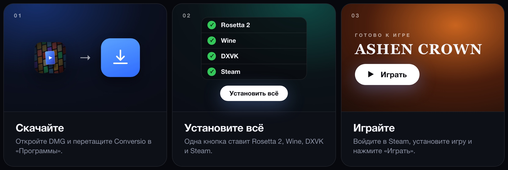
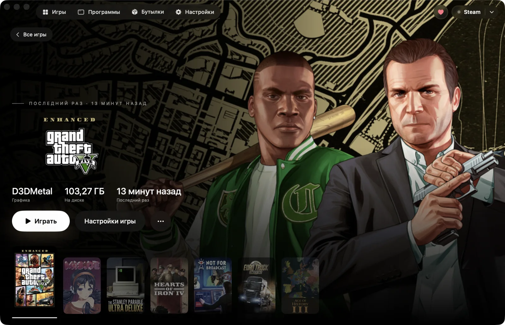
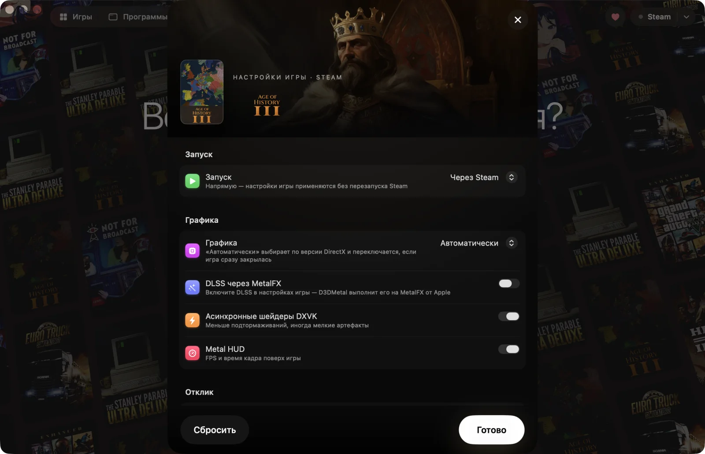
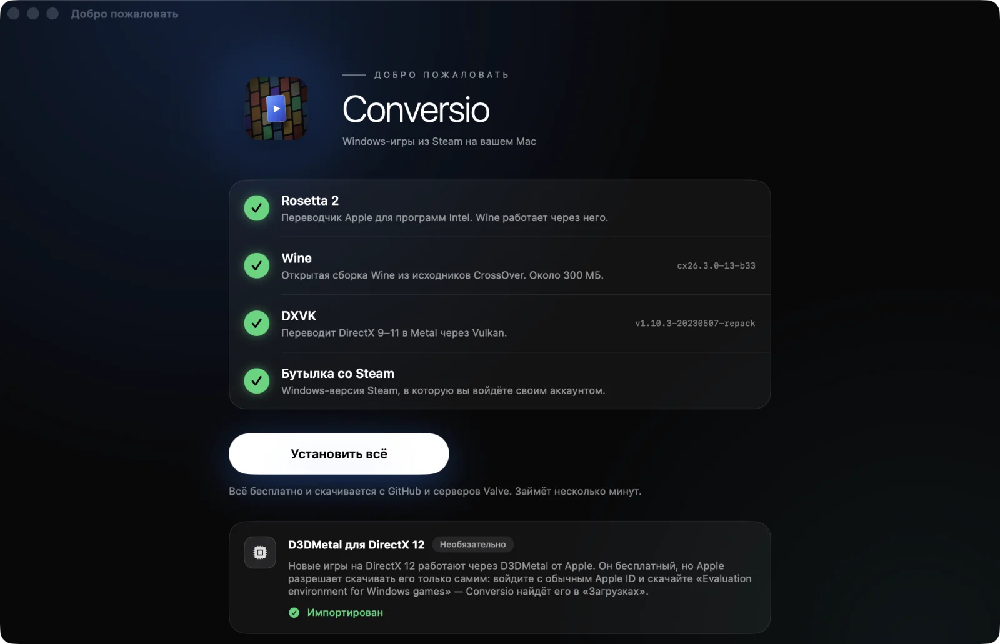
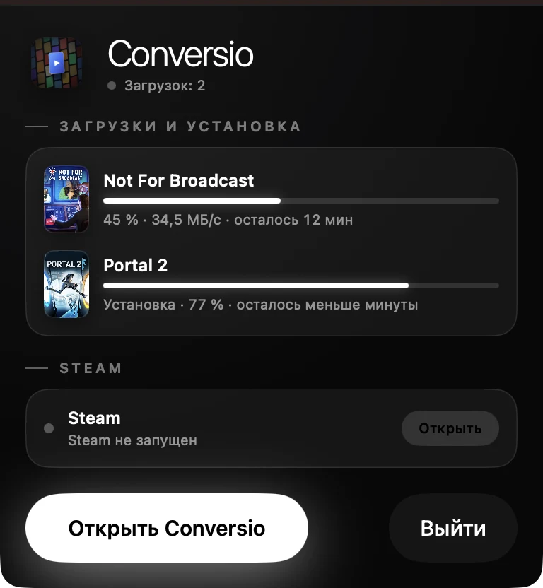
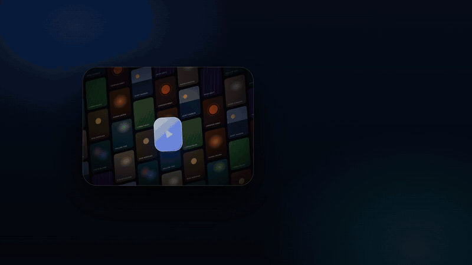
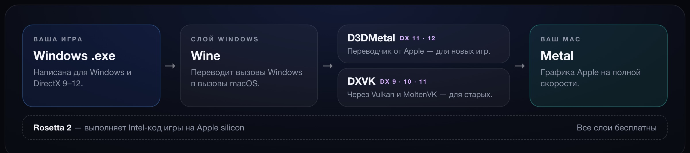

  

<h1 align="center">Conversio</h1>

  <b>Windows-игры из Steam на вашем Mac</b> 
  Бесплатно. Без Windows, виртуальной машины и подписки · от <a href="https://github.com/theoron-apps">Theoron</a>

  
  
  
  
  

  

  <a href="README.md">English</a> · Русский · <a href="README.uk.md">Українська</a>

  

  <a href="#быстрый-старт">Быстрый старт</a> ·
  <a href="#как-это-выглядит">Как это выглядит</a> ·
  <a href="#что-умеет">Что умеет</a> ·
  <a href="#как-это-работает">Как это работает</a> ·
  <a href="#игры">Игры</a> ·
  <a href="#вопросы">Вопросы</a> ·
  <a href="#гайды">Гайды</a>

---

Conversio запускает Windows-версию Steam и ваши Windows-игры на Mac с Apple Silicon — как CrossOver, только **бесплатно**. Всё ставится одной кнопкой, игры собираются на стене обложек из Steam, графика для каждой игры подбирается сама, а любую игру можно настроить отдельно.

## Быстрый старт

  

1. **Скачайте** `Conversio-<версия>.dmg` из [Releases](../../releases/latest), откройте его и перетащите **Conversio** в **Программы**.
2. **Откройте Conversio и нажмите «Установить всё».** Приложение установит Rosetta 2 (macOS спросит пароль), скачает Wine (около 300 МБ) и DXVK, создаст бутылку и поставит в неё Steam.
3. **Войдите в Steam, установите игру и нажмите «Играть».** Игра появится в Conversio, как только Steam её скачает.

Нужен Mac с Apple Silicon (M1 или новее), macOS 15 Sequoia или новее и около 2 ГБ свободного места плюс место для игр.

> [!IMPORTANT]
> **При первом открытии** macOS скажет, что не может проверить разработчика: Conversio пока не подписан платным Apple Developer ID. Нажмите **Готово**, откройте **Системные настройки → Конфиденциальность и безопасность**, прокрутите до раздела **Безопасность** и нажмите **Всё равно открыть**. Это нужно сделать один раз.

> [!TIP]
> То же самое делает одна команда в Терминале: `xattr -dr com.apple.quarantine /Applications/Conversio.app`

## Как это выглядит

<table>
  <tr>
    <td width="50%" valign="top">
       
      <b>Страница у каждой игры</b> 
      Арт из Steam, графика, на которой игра идёт, размер на диске и одна кнопка «Играть».
    </td>
    <td width="50%" valign="top">
       
      <b>Настройки у каждой игры</b> 
      Способ запуска, графика, ограничение FPS и Metal HUD — не трогая остальные игры.
    </td>
  </tr>
  <tr>
    <td width="50%" valign="top">
       
      <b>Установка одной кнопкой</b> 
      Всё, что нужно играм, скачивается и ставится само.
    </td>
    <td width="50%" valign="top" align="center">
       
      <b>Загрузки в строке меню</b> 
      Скорость, оставшееся время и запущенные игры — не открывая окно.
    </td>
  </tr>
</table>

## Что умеет

  

- **Установка одной кнопкой** — Rosetta 2, Wine, DXVK и Steam для Windows скачиваются и ставятся сами.
- **Библиотека Steam** — установленные игры появляются сами, с обложками из Steam, поиском и списком недавних.
- **Автоматическая графика** — Conversio сам выбирает D3DMetal или DXVK для каждой игры. Если игра не запустилась, пробует другой вариант и запоминает рабочий.
- **Настройки каждой игры** — графика, Metal HUD с FPS, ограничение FPS, минимальная задержка, аргументы запуска и переменные окружения.
- **Профили игр** — GTA V Enhanced и Legacy, Euro Truck Simulator 2, American Truck Simulator, Hearts of Iron IV и Dota 2 настраиваются сами при первом появлении.
- **DirectX 12** — импортируйте D3DMetal из бесплатного Game Porting Toolkit от Apple, и игры на DirectX 11 и 12 заработают на Metal.
- **Следит за игрой** — предупреждает, когда запись экрана или нехватка памяти замедляют игру, не даёт Mac уснуть во время игры и загрузки, показывает загрузки в строке меню.
- **Бутылки и другие программы** — отдельные Windows, как в CrossOver; запускается любой `.exe`, `.msi` или `.bat`, а не только игры из Steam.

На русском, украинском и английском.

  

## Как это работает

Сами по себе Windows-игры на macOS не запускаются. Conversio ставит между ними несколько бесплатных слоёв:

  

| Слой | Что делает | Откуда берётся |
|---|---|---|
| **Wine** | Запускает программы Windows: переводит вызовы Windows в вызовы macOS | Наши сборки открытого Wine из CrossOver: [conversio-wine](https://github.com/theoron-apps/conversio-wine) |
| **DXVK** | Переводит DirectX 9–11 в Vulkan, а MoltenVK превращает его в Metal | [DXVK-macOS](https://github.com/Gcenx/DXVK-macOS) |
| **D3DMetal** *(по желанию)* | Перевод DirectX 11 и 12 в Metal от самой Apple | Бесплатный [Game Porting Toolkit](https://developer.apple.com/games/game-porting-toolkit/) от Apple |
| **Rosetta 2** | Выполняет код для Intel на Apple Silicon | Встроена в macOS |

Покупать ничего не нужно. Wine и DXVK скачиваются сами. D3DMetal тоже бесплатен, но Apple не разрешает другим приложениям его распространять, поэтому его скачиваете вы сами с обычным Apple ID — по [гайду](docs/guides/d3dmetal.ru.md) это две минуты.

## Игры

Заработает ли игра, зависит от самой игры:

- **Обычно работают:** большинство одиночных игр на DirectX 9–12 и многие инди-игры.
- **Часто не работают:** игры с античитом уровня ядра (некоторые варианты EasyAntiCheat, BattlEye, Vanguard, Ricochet) и игры, которым нужны инструкции AVX2, которые Rosetta 2 не переводит на старых macOS.

Проверено на MacBook Pro с M5 Pro, macOS 26:

| Игра | Статус | Примечания |
|---|---|---|
| GTA V Enhanced | ✅ Работает | Сюжетный режим, 85–120 FPS в 1728×1117. Нужен D3DMetal из Game Porting Toolkit 4.0 beta 3 или новее — [гайд и настройки](docs/guides/gta-v-enhanced.ru.md) |
| GTA V Legacy | ✅ Работает | Сюжетный режим, окно без рамки |
| Euro Truck Simulator 2 | ✅ Работает | D3DMetal |
| The Stanley Parable: Ultra Deluxe | ✅ Работает | D3DMetal |
| R.E.P.O. | ✅ Работает | D3DMetal |
| Age of History 3 | ✅ Работает | |
| Dota 2 | ✅ Работает | Звук настраивает профиль игры |
| Not For Broadcast | ✅ Работает | Выбирайте окно без рамки: эксклюзивный полный экран обрезается |
| City Car Driving | ✅ Работает | 32-битная, DXVK выбирается автоматически |
| Hearts of Iron IV | ⚠️ Работает без лаунчера | Лаунчер Paradox остаётся пустым, поэтому Conversio запускает игру напрямую |

Нашли игру, которая работает или нет? [Расскажите об этом](../../issues/new/choose) — это поможет всем.

## Вопросы

<b>Это правда бесплатно?</b>

 
Да. Conversio, Wine и DXVK бесплатны, D3DMetal от Apple тоже — для загрузки нужен только обычный Apple ID. Играете вы в игры, которые у вас уже есть в Steam.

<b>Нужна ли Windows или виртуальная машина?</b>

 
Нет. Игры работают как обычные процессы Mac: Wine переводит вызовы Windows, а D3DMetal или DXVK — DirectX в Metal. Не нужна ни лицензия Windows, ни вторая система в фоне.

<b>Чем это отличается от CrossOver?</b>

 
CrossOver — платный продукт с официальной поддержкой и гораздо более широким набором программ Windows. Conversio бесплатен и занят одним делом — играми из Steam — и использует Wine, собранный из открытого кода CrossOver.

<b>Работает ли мультиплеер?</b>

 
Там, где это позволяет античит игры. Dota 2 работает; GTA Online — нет: BattlEye нужен драйвер ядра Windows. Игры с античитом уровня ядра обычно вообще не запускаются.

<b>Безопасно ли это для аккаунта Steam?</b>

 
Вы входите в настоящий клиент Steam для Windows. Conversio не видит ваш пароль, и своих серверов у него нет — см. <a href="#приватность">Приватность</a>.

<b>Почему macOS ругается при первом запуске?</b>

 
Приложение пока не подписано платным Apple Developer ID, поэтому macOS один раз просит подтвердить первый запуск. Шаги описаны в разделе <a href="#быстрый-старт">Быстрый старт</a>.

<b>Работает ли на Mac с Intel?</b>

 
Нет. Conversio нужен Apple Silicon (M1 или новее) и macOS 15 или новее.

<b>Можно ли запускать программы не из Steam?</b>

 
Да. Откройте в Conversio любой <code>.exe</code>, <code>.msi</code> или <code>.bat</code> или добавьте программу в библиотеку на странице бутылки.

<b>Игра не запускается. Что делать?</b>

 
Нажмите правой кнопкой на обложку и выберите <b>«Почему не запускается?…»</b> — Conversio покажет, что нашёл. Затем попробуйте другую графику (D3DMetal ↔ DXVK) или другой способ запуска. Подробнее — в <a href="docs/guides/troubleshooting.ru.md">гайде «Если игра не работает»</a>.

## Гайды

Пошагово:

- **[Установка](docs/guides/install.ru.md)** — от DMG до первой игры
- **[D3DMetal для DirectX 12](docs/guides/d3dmetal.ru.md)** — где скачать и как импортировать
- **[GTA V Enhanced](docs/guides/gta-v-enhanced.ru.md)** — первый запуск и проверенные настройки графики
- **[Если игра не работает](docs/guides/troubleshooting.ru.md)** — когда игра не запускается или тормозит

## Справка

<b>Способы запуска</b>

 

Каждую игру можно запускать одним из двух способов — выберите его в **Настройках игры** (правый клик по обложке):

| Способ | Как работает | Когда выбирать |
|---|---|---|
| **Через Steam** *(по умолчанию)* | Conversio просит Steam запустить игру, как на Windows | Большинство игр, особенно с лаунчерами и DRM |
| **Напрямую** | Steam работает в фоне, а `.exe` игры запускает сам Conversio | Когда нужно, чтобы настройки игры применялись без перезапуска Steam |

Игры, запущенные через Steam, наследуют настройки Steam. Если у игры свои настройки, а Steam уже запущен с другими, Conversio предложит перезапустить Steam.

<b>Настройки игры</b>

 

| Настройка | Что делает |
|---|---|
| Графика | **Автоматически**, **D3DMetal** (если импортирован) для DirectX 11/12, **DXVK** для DirectX 9–11 или как в бутылке |
| DLSS через MetalFX | Апскейлинг Apple для игр с поддержкой DLSS — только D3DMetal |
| Асинхронные шейдеры DXVK | Меньше подтормаживаний, пока компилируются шейдеры |
| Metal HUD | FPS, время кадра и загрузка GPU поверх игры |
| Минимальная задержка | Один кадр в очереди и без VSync — только DXVK |
| Ограничение FPS | 30, 60, 90, 117 или 120 — работает с D3DMetal и DXVK |
| Аргументы запуска | Например, `-dx11` или `-windowed` |
| Переменные окружения | `КЛЮЧ=значение`, по одной на строку |

Синхронизация (**MSync**) и режим Retina задаются для всей бутылки — на её странице.

<b>DirectX 12 через D3DMetal</b>

 

1. Откройте [страницу загрузок Apple](https://developer.apple.com/download/all/?q=game%20porting%20toolkit) и войдите с Apple ID (хватит бесплатного аккаунта).
2. Скачайте **Evaluation environment for Windows games** — самую новую версию, **4.0 beta 3 или новее**. Она нужна играм на DirectX 12, например GTA V Enhanced.
3. Conversio сам найдёт DMG в «Загрузках»: нажмите **Импортировать** на экране приветствия или в **Настройки → Движок**.

После этого **D3DMetal** станет графикой по умолчанию во всех бутылках. Удалить его можно там же. В [полном гайде](docs/guides/d3dmetal.ru.md) описано, что делать, если импорт не удался.

<b>Бутылки</b>

 

Бутылка — это отдельная Windows: свой диск C:, реестр, установленные программы и настройки. Большинству хватит одной бутылки со Steam. Создайте ещё одну (**Файл → Новая бутылка…**), если игре нужна другая версия Windows или настройки, которые ломают другие игры.

На странице бутылки можно открыть Steam, запустить любой установщик или программу Windows, добавить программу в библиотеку, открыть диск C: в Finder, открыть настройки Wine, реестр или диспетчер задач и остановить всё, что работает в бутылке.

<b>Обновления</b>

 

Conversio проверяет новую версию при каждом запуске и каждые шесть часов. Когда она выходит, приложение предлагает **Скачать** её, напомнить **Позже** или **Пропустить** эту версию. Откройте новый DMG и замените приложение в «Программах» — бутылки, игры и настройки сохранятся, а Conversio покажет, что нового.

Отключить проверку или проверить вручную можно в **Настройки → О приложении → Обновления**. Движок обновляется отдельно в **Настройки → Движок**.

<b>Где что лежит</b>

 

| Что | Где |
|---|---|
| Движок (Wine, DXVK, D3DMetal) | `~/Library/Application Support/Conversio/Engine` |
| Бутылки с играми и сохранениями | `~/Library/Application Support/Conversio/Bottles` |
| Журналы | `~/Library/Logs/Conversio` |
| Обложки | `~/Library/Caches/Conversio` |

<b>Удаление</b>

 

Закройте Conversio, удалите его из «Программ» и, если хотите убрать игры и сохранения, удалите `~/Library/Application Support/Conversio`.

## Что дальше

- Более новый Wine из исходников CrossOver 27, с лучшей поддержкой DirectX 12, — когда они станут открытыми.
- Режим Retina для отдельной игры, а не для всей бутылки.
- Игровой режим macOS для Windows-игр.
- Новые профили игр — какие будут первыми, решают [отчёты об играх](../../issues/new/choose).

## Приватность

- Conversio не собирает аналитику.
- Доступ в сеть нужен только для загрузки движка с GitHub, установщика Steam и обложек игр с серверов Valve и для проверки обновлений в этом репозитории GitHub, которая ничего о вас не отправляет.
- Данные аккаунта Steam вводятся только в самом Steam.

## Лицензия и благодарности

Conversio можно бесплатно скачивать и использовать. Исходный код приложения закрыт; сборки Wine, на которых оно работает, открыты под LGPL в [conversio-wine](https://github.com/theoron-apps/conversio-wine). © 2026 Theoron.

Conversio стоит на плечах [Wine](https://www.winehq.org) (LGPL), [DXVK](https://github.com/doitsujin/dxvk) (zlib), [MoltenVK](https://github.com/KhronosGroup/MoltenVK) (Apache 2.0), сборок для macOS от [Gcenx](https://github.com/Gcenx) и Game Porting Toolkit от Apple. Steam — товарный знак Valve Corporation. Conversio не связан с Valve, Apple, Microsoft или CodeWeavers. Игры на иллюстрациях и в анимации вымышленные; арт игр на скриншотах принадлежит их издателям.

---

  Conversio бесплатен. Если он вам помог, можно <a href="https://send.monobank.ua/jar/2jGp4yDQPd"><b>поддержать разработку</b></a> любой картой Visa или Mastercard, через Apple Pay или Google Pay.

  Новости и поддержка — Telegram <a href="https://t.me/TheoronApps">@TheoronApps</a> · <a href="mailto:theoronapps@gmail.com">theoronapps@gmail.com</a>

