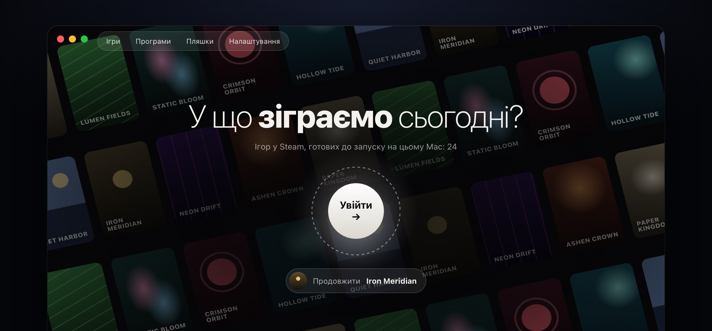
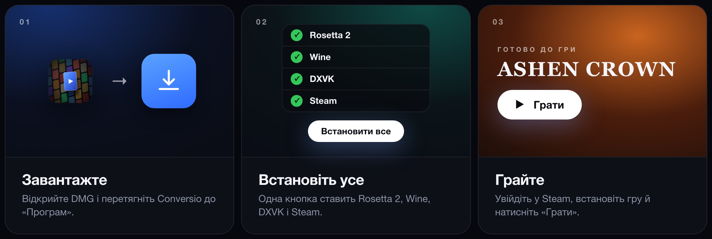
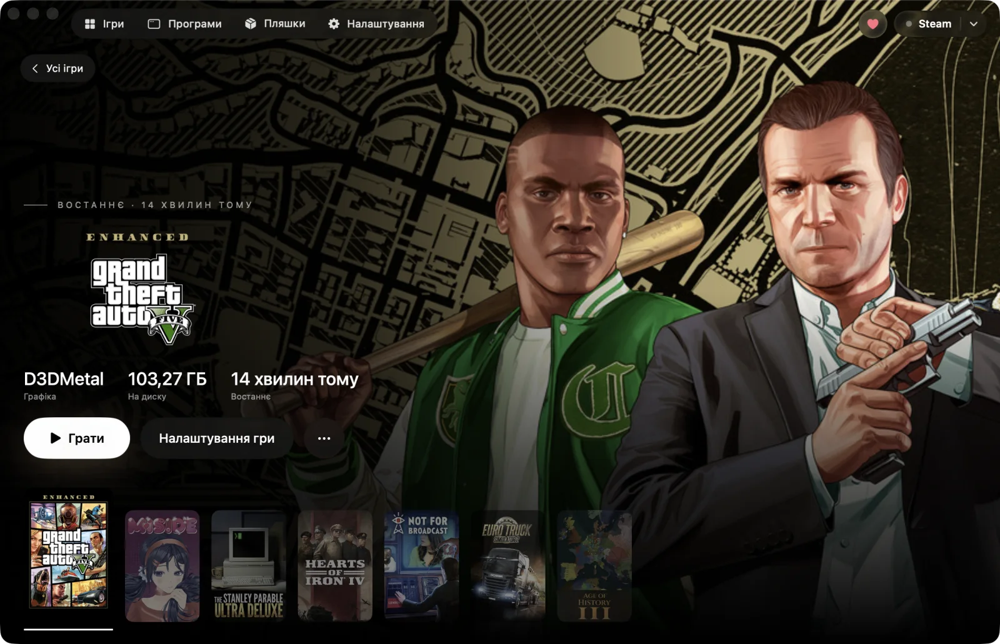
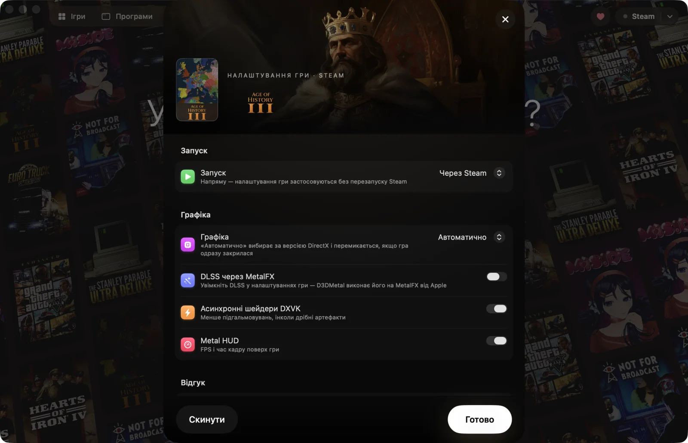
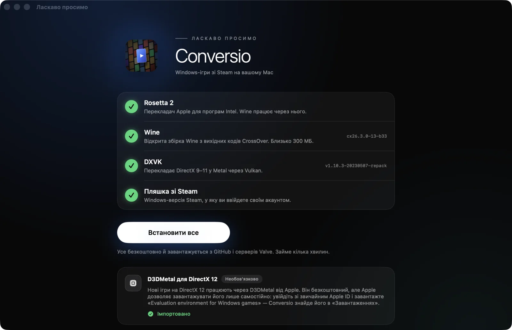
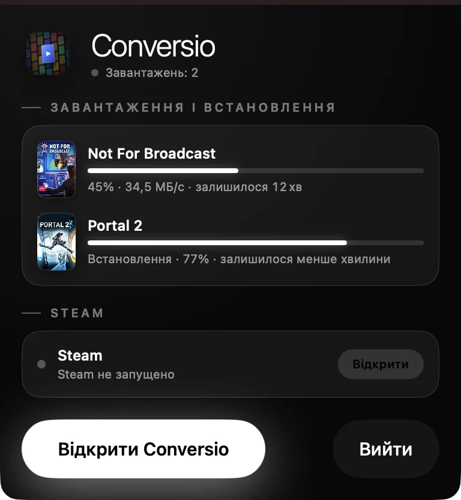
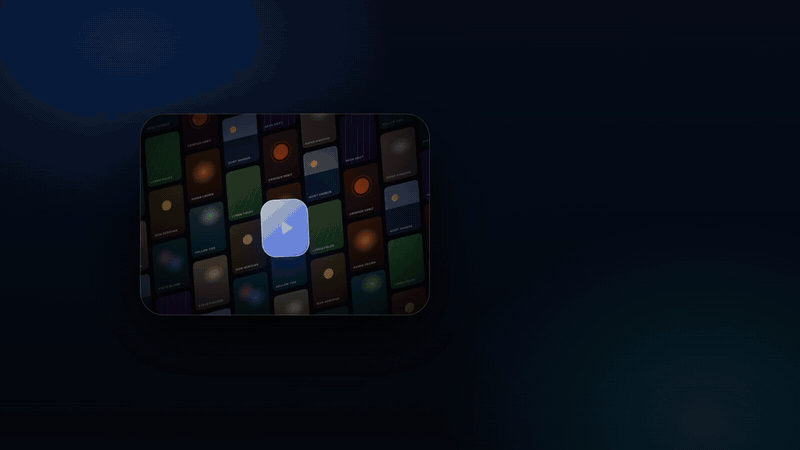
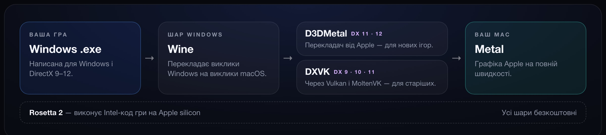

  

<h1 align="center">Conversio</h1>

  <b>Windows-ігри зі Steam на вашому Mac</b> 
  Безкоштовно. Без Windows, віртуальної машини та підписки · від <a href="https://github.com/theoron-apps">Theoron</a>

  
  
  
  
  

  

  <a href="README.md">English</a> · <a href="README.ru.md">Русский</a> · Українська

  

  <a href="#швидкий-старт">Швидкий старт</a> ·
  <a href="#який-це-має-вигляд">Який це має вигляд</a> ·
  <a href="#що-вміє">Що вміє</a> ·
  <a href="#як-це-працює">Як це працює</a> ·
  <a href="#ігри">Ігри</a> ·
  <a href="#запитання">Запитання</a> ·
  <a href="#гайди">Гайди</a>

---

Conversio запускає Windows-версію Steam і ваші Windows-ігри на Mac з Apple Silicon — як CrossOver, тільки **безкоштовно**. Усе встановлюється однією кнопкою, ігри збираються на стіні обкладинок зі Steam, графіка для кожної гри добирається сама, а будь-яку гру можна налаштувати окремо.

## Швидкий старт

  

1. **Завантажте** `Conversio-<версія>.dmg` з [Releases](../../releases/latest), відкрийте його й перетягніть **Conversio** до **Програм**.
2. **Відкрийте Conversio й натисніть «Встановити все».** Застосунок встановить Rosetta 2 (macOS спитає пароль), завантажить Wine (близько 300 МБ) і DXVK, створить пляшку та поставить у неї Steam.
3. **Увійдіть у Steam, встановіть гру й натисніть «Грати».** Гра з'явиться в Conversio, щойно Steam її завантажить.

Потрібен Mac з Apple Silicon (M1 або новіший), macOS 15 Sequoia або новіша та близько 2 ГБ вільного місця плюс місце для ігор.

> [!IMPORTANT]
> **Під час першого відкриття** macOS скаже, що не може перевірити розробника: Conversio поки не підписаний платним Apple Developer ID. Натисніть **Готово**, відкрийте **Системні параметри → Приватність і безпека**, прокрутіть до розділу **Безпека** й натисніть **Усе одно відкрити**. Це треба зробити один раз.

> [!TIP]
> Те саме робить одна команда в Терміналі: `xattr -dr com.apple.quarantine /Applications/Conversio.app`

## Який це має вигляд

<table>
  <tr>
    <td width="50%" valign="top">
       
      <b>Сторінка в кожної гри</b> 
      Арт зі Steam, графіка, на якій гра працює, розмір на диску й одна кнопка «Грати».
    </td>
    <td width="50%" valign="top">
       
      <b>Налаштування в кожної гри</b> 
      Спосіб запуску, графіка, обмеження FPS і Metal HUD — не чіпаючи інші ігри.
    </td>
  </tr>
  <tr>
    <td width="50%" valign="top">
       
      <b>Встановлення однією кнопкою</b> 
      Усе, що потрібно іграм, завантажується та встановлюється саме.
    </td>
    <td width="50%" valign="top" align="center">
       
      <b>Завантаження в рядку меню</b> 
      Швидкість, час, що залишився, і запущені ігри — не відкриваючи вікно.
    </td>
  </tr>
</table>

## Що вміє

  

- **Встановлення однією кнопкою** — Rosetta 2, Wine, DXVK і Steam для Windows завантажуються та встановлюються самі.
- **Бібліотека Steam** — встановлені ігри з'являються самі, з обкладинками зі Steam, пошуком і списком нещодавніх.
- **Автоматична графіка** — Conversio сам обирає D3DMetal або DXVK для кожної гри. Якщо гра не запустилася, пробує інший варіант і запам'ятовує робочий.
- **Налаштування кожної гри** — графіка, Metal HUD з FPS, обмеження FPS, мінімальна затримка, аргументи запуску та змінні середовища.
- **Профілі ігор** — GTA V Enhanced і Legacy, Euro Truck Simulator 2, American Truck Simulator, Hearts of Iron IV і Dota 2 налаштовуються самі, щойно з'являються.
- **DirectX 12** — імпортуйте D3DMetal з безкоштовного Game Porting Toolkit від Apple, і ігри на DirectX 11 і 12 запрацюють на Metal.
- **Стежить за грою** — попереджає, коли запис екрана або брак пам'яті сповільнюють гру, не дає Mac заснути під час гри й завантаження, показує завантаження в рядку меню.
- **Пляшки та інші програми** — окремі Windows, як у CrossOver; запускається будь-який `.exe`, `.msi` або `.bat`, а не лише ігри зі Steam.

Українською, англійською та російською.

  

## Як це працює

Самі по собі Windows-ігри на macOS не запускаються. Conversio ставить між ними кілька безкоштовних шарів:

  

| Шар | Що робить | Звідки береться |
|---|---|---|
| **Wine** | Запускає Windows-програми: перекладає виклики Windows у виклики macOS | Наші збірки відкритого Wine з вихідних кодів CrossOver: [conversio-wine](https://github.com/theoron-apps/conversio-wine) |
| **DXVK** | Перекладає DirectX 9–11 у Vulkan, а MoltenVK — у Metal | [DXVK-macOS](https://github.com/Gcenx/DXVK-macOS) |
| **D3DMetal** *(за бажанням)* | Переклад DirectX 11 і 12 у Metal від самої Apple | Безкоштовний [Game Porting Toolkit](https://developer.apple.com/games/game-porting-toolkit/) від Apple |
| **Rosetta 2** | Запускає код Intel на Apple Silicon | Вбудована в macOS |

Нічого купувати не треба. Wine і DXVK завантажуються автоматично. D3DMetal теж безкоштовний, але Apple не дозволяє вбудовувати його в інші застосунки, тому його треба завантажити самому зі звичайним Apple ID — за [гайдом](docs/guides/d3dmetal.ru.md) (російською) це дві хвилини.

## Ігри

Чи запрацює гра, залежить від самої гри:

- **Зазвичай працюють:** більшість одиночних ігор на DirectX 9–12 і багато інді-ігор.
- **Часто не працюють:** ігри з античитом рівня ядра (деякі варіанти EasyAntiCheat, BattlEye, Vanguard, Ricochet) та ігри, яким потрібні інструкції AVX2, які Rosetta 2 не перекладає на старих macOS.

Перевірено на MacBook Pro з M5 Pro, macOS 26:

| Гра | Статус | Примітки |
|---|---|---|
| GTA V Enhanced | ✅ Працює | Сюжетний режим, 85–120 FPS у 1728×1117. Потрібен D3DMetal з Game Porting Toolkit 4.0 beta 3 або новішого — [гайд і налаштування](docs/guides/gta-v-enhanced.ru.md) (російською) |
| GTA V Legacy | ✅ Працює | Сюжетний режим, вікно без рамки |
| Euro Truck Simulator 2 | ✅ Працює | D3DMetal |
| The Stanley Parable: Ultra Deluxe | ✅ Працює | D3DMetal |
| R.E.P.O. | ✅ Працює | D3DMetal |
| Age of History 3 | ✅ Працює | |
| Dota 2 | ✅ Працює | Звук налаштовує профіль гри |
| Not For Broadcast | ✅ Працює | Обирайте вікно без рамки: ексклюзивний повний екран обрізається |
| City Car Driving | ✅ Працює | 32-бітна, DXVK обирається автоматично |
| Hearts of Iron IV | ⚠️ Працює без лаунчера | Лаунчер Paradox лишається порожнім, тому Conversio запускає гру напряму |

Знайшли гру, яка працює чи ні? [Розкажіть про це](../../issues/new/choose) — це допоможе всім.

## Запитання

<b>Це справді безкоштовно?</b>

 
Так. Conversio, Wine і DXVK безкоштовні, D3DMetal від Apple теж — для завантаження потрібен лише звичайний Apple ID. Граєте ви в ігри, які вже маєте в Steam.

<b>Чи потрібна Windows або віртуальна машина?</b>

 
Ні. Ігри працюють як звичайні процеси Mac: Wine перекладає виклики Windows, а D3DMetal або DXVK — DirectX у Metal. Не потрібна ні ліцензія Windows, ні друга система у фоні.

<b>Чим це відрізняється від CrossOver?</b>

 
CrossOver — платний продукт з офіційною підтримкою та значно ширшим набором програм Windows. Conversio безкоштовний і зайнятий однією справою — іграми зі Steam — і використовує Wine, зібраний з відкритого коду CrossOver.

<b>Чи працює мультиплеєр?</b>

 
Там, де це дозволяє античит гри. Dota 2 працює; GTA Online — ні: BattlEye потрібен драйвер ядра Windows. Ігри з античитом рівня ядра зазвичай узагалі не запускаються.

<b>Чи безпечно це для акаунта Steam?</b>

 
Ви входите в справжній клієнт Steam для Windows. Conversio не бачить ваш пароль, і власних серверів у нього немає — див. <a href="#конфіденційність">Конфіденційність</a>.

<b>Чому macOS попереджає під час першого запуску?</b>

 
Застосунок поки не підписаний платним Apple Developer ID, тому macOS один раз просить підтвердити перший запуск. Кроки описано в розділі <a href="#швидкий-старт">Швидкий старт</a>.

<b>Чи працює на Mac з Intel?</b>

 
Ні. Conversio потрібен Apple Silicon (M1 або новіший) і macOS 15 або новіша.

<b>Чи можна запускати програми не зі Steam?</b>

 
Так. Відкрийте в Conversio будь-який <code>.exe</code>, <code>.msi</code> або <code>.bat</code> чи додайте програму до бібліотеки на сторінці пляшки.

<b>Гра не запускається. Що робити?</b>

 
Клацніть правою кнопкою на обкладинці й виберіть <b>«Чому не запускається?…»</b> — Conversio покаже, що знайшов. Потім спробуйте іншу графіку (D3DMetal ↔ DXVK) або інший спосіб запуску. Докладніше — у <a href="docs/guides/troubleshooting.ru.md">гайді «Якщо гра не працює»</a> (російською).

## Гайди

Покроково (російською та англійською):

- **[Встановлення](docs/guides/install.ru.md)** — від DMG до першої гри
- **[D3DMetal для DirectX 12](docs/guides/d3dmetal.ru.md)** — де завантажити і як імпортувати
- **[GTA V Enhanced](docs/guides/gta-v-enhanced.ru.md)** — перший запуск і перевірені налаштування графіки
- **[Якщо гра не працює](docs/guides/troubleshooting.ru.md)** — коли гра не запускається або гальмує

## Довідка

<b>Способи запуску</b>

 

Кожну гру можна запускати одним із двох способів — виберіть у **Налаштуваннях гри** (правий клік по обкладинці):

| Спосіб | Як працює | Коли підходить |
|---|---|---|
| **Через Steam** *(за замовчуванням)* | Conversio просить Steam запустити гру, як на Windows | Більшість ігор, особливо з лаунчерами та DRM |
| **Напряму** | Steam працює у фоні, а `.exe` гри запускає сам Conversio | Коли треба, щоб налаштування гри застосовувалися без перезапуску Steam |

Ігри, запущені через Steam, успадковують налаштування Steam. Якщо в гри власні налаштування, а Steam уже запущено з іншими, Conversio запропонує перезапустити Steam.

<b>Налаштування гри</b>

 

| Налаштування | Що робить |
|---|---|
| Графіка | **Автоматично**, **D3DMetal** (якщо імпортовано) для DirectX 11/12, **DXVK** для DirectX 9–11 або як у пляшці |
| DLSS через MetalFX | Апскейлінг Apple для ігор з підтримкою DLSS — лише D3DMetal |
| Асинхронні шейдери DXVK | Менше підгальмовувань, поки компілюються шейдери |
| Metal HUD | FPS, час кадру та завантаження GPU поверх гри |
| Мінімальна затримка | Один кадр у черзі й без VSync — лише DXVK |
| Обмеження FPS | 30, 60, 90, 117 або 120 — працює з D3DMetal і DXVK |
| Аргументи запуску | Наприклад, `-dx11` або `-windowed` |
| Змінні середовища | `КЛЮЧ=значення`, по одній на рядок |

Синхронізація (**MSync**) і режим Retina задаються для всієї пляшки — на її сторінці.

<b>DirectX 12 через D3DMetal</b>

 

1. Відкрийте [сторінку завантажень Apple](https://developer.apple.com/download/all/?q=game%20porting%20toolkit) і увійдіть з Apple ID (вистачить безкоштовного акаунта).
2. Завантажте **Evaluation environment for Windows games** — найновішу версію, **4.0 beta 3 або новішу**. Вона потрібна іграм на DirectX 12, наприклад GTA V Enhanced.
3. Conversio сам знайде DMG у «Завантаженнях»: натисніть **Імпортувати** на екрані привітання або в **Налаштування → Рушій**.

Після цього **D3DMetal** стане графікою за замовчуванням в усіх пляшках. Видалити його можна там само. У [повному гайді](docs/guides/d3dmetal.ru.md) (російською) описано, що робити, якщо імпорт не вдався.

<b>Пляшки</b>

 

Пляшка — це окрема Windows: свій диск C:, реєстр, встановлені програми та налаштування. Більшості вистачить однієї пляшки зі Steam. Створіть ще одну (**Файл → Нова пляшка…**), якщо грі потрібна інша версія Windows або налаштування, що ламають інші ігри.

На сторінці пляшки можна відкрити Steam, запустити будь-який інсталятор або програму Windows, додати програму до бібліотеки, відкрити диск C: у Finder, відкрити налаштування Wine, реєстр або диспетчер завдань і зупинити все, що працює в пляшці.

<b>Оновлення</b>

 

Conversio перевіряє нову версію під час кожного запуску та кожні шість годин. Коли вона виходить, застосунок пропонує **Завантажити**, нагадати **Пізніше** або **Пропустити версію**. Відкрийте новий DMG і замініть застосунок у «Програмах» — пляшки, ігри та налаштування збережуться, а Conversio покаже, що нового.

Вимкнути перевірку або перевірити вручну можна в **Налаштуваннях → Про застосунок → Оновлення**. Рушій оновлюється окремо в **Налаштуваннях → Рушій**.

<b>Де що лежить</b>

 

| Що | Де |
|---|---|
| Рушій (Wine, DXVK, D3DMetal) | `~/Library/Application Support/Conversio/Engine` |
| Пляшки з іграми та збереженнями | `~/Library/Application Support/Conversio/Bottles` |
| Журнали | `~/Library/Logs/Conversio` |
| Обкладинки | `~/Library/Caches/Conversio` |

<b>Видалення</b>

 

Закрийте Conversio, видаліть його з «Програм» і, якщо хочете видалити ігри та збереження, видаліть папку `~/Library/Application Support/Conversio`.

## Що далі

- Новіший Wine з вихідних кодів CrossOver 27, з кращою підтримкою DirectX 12, — коли вони стануть відкритими.
- Режим Retina для окремої гри, а не для всієї пляшки.
- Ігровий режим macOS для Windows-ігор.
- Нові профілі ігор — які будуть першими, вирішують [звіти про ігри](../../issues/new/choose).

## Конфіденційність

- Conversio не збирає аналітику.
- У мережу застосунок звертається лише по рушій на GitHub, інсталятор Steam та обкладинки ігор на сервери Valve і для перевірки оновлень у цьому репозиторії — про вас при цьому нічого не надсилається.
- Акаунт Steam вводиться лише в сам Steam.

## Ліцензія та подяки

Conversio можна безкоштовно завантажувати й використовувати. Вихідний код застосунку закритий; збірки Wine, на яких він працює, відкриті під LGPL у [conversio-wine](https://github.com/theoron-apps/conversio-wine). © 2026 Theoron.

Conversio спирається на [Wine](https://www.winehq.org) (LGPL), [DXVK](https://github.com/doitsujin/dxvk) (zlib), [MoltenVK](https://github.com/KhronosGroup/MoltenVK) (Apache 2.0), збірки для macOS від [Gcenx](https://github.com/Gcenx) і Game Porting Toolkit від Apple. Steam — торговельна марка Valve Corporation. Conversio не пов'язаний з Valve, Apple, Microsoft або CodeWeavers. Ігри на ілюстраціях і в анімації вигадані; арт ігор на скриншотах належить їхнім видавцям.

---

  Conversio безкоштовний. Якщо він вам допоміг, можна <a href="https://send.monobank.ua/jar/2jGp4yDQPd"><b>підтримати розробку</b></a> будь-якою карткою Visa або Mastercard, через Apple Pay чи Google Pay.

  Новини та підтримка — Telegram <a href="https://t.me/TheoronApps">@TheoronApps</a> · <a href="mailto:theoronapps@gmail.com">theoronapps@gmail.com</a>

