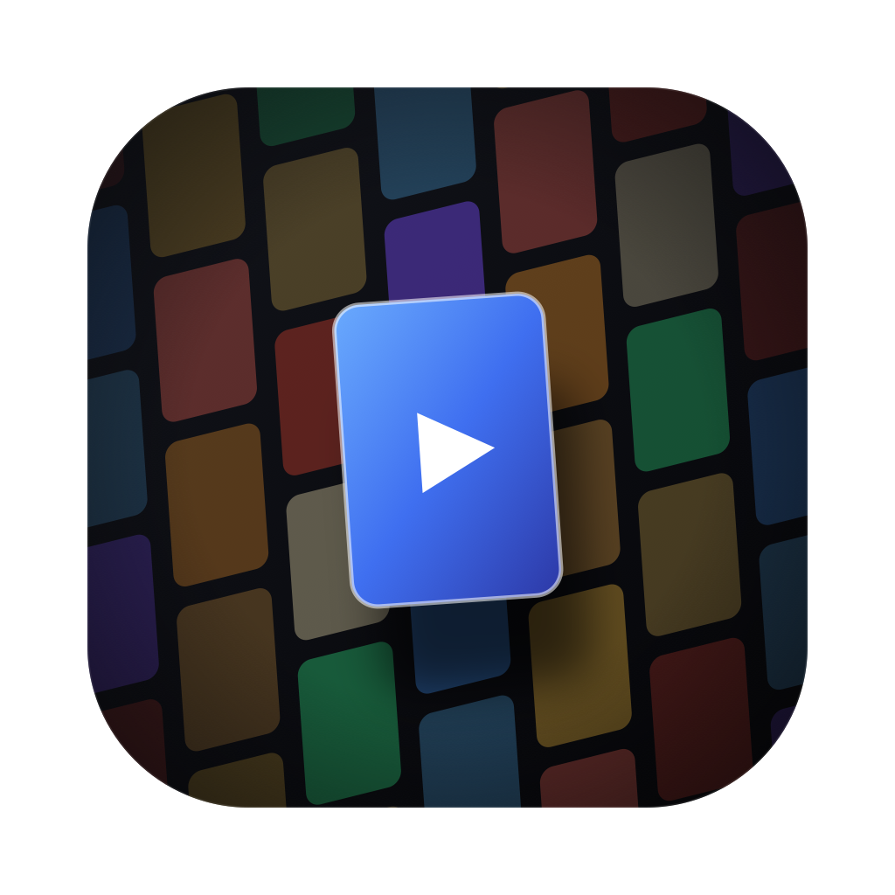
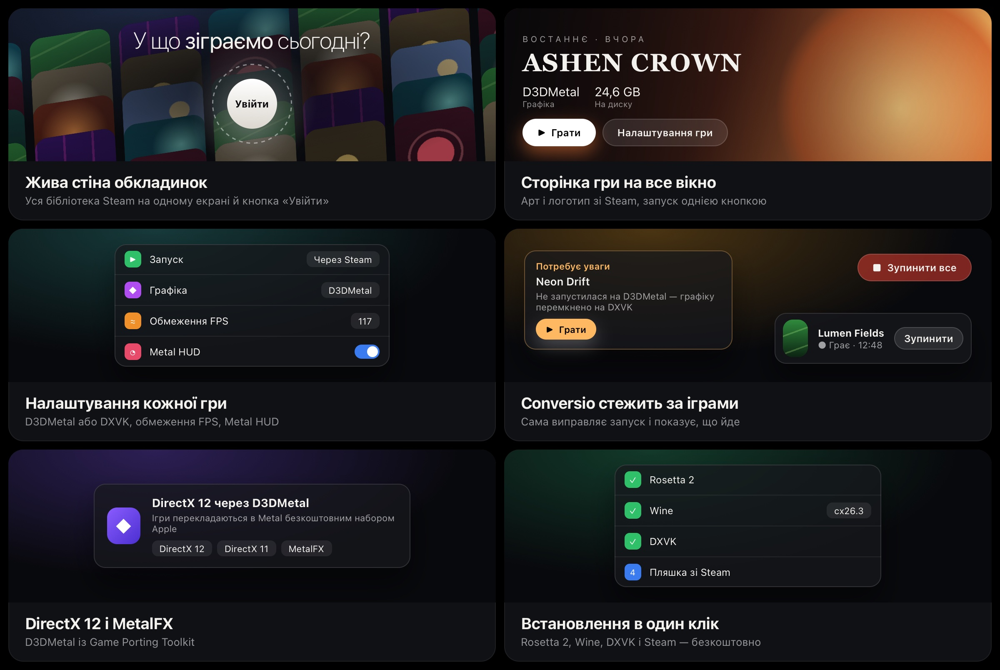

  

<h1 align="center">Conversio</h1>

Windows-ігри зі Steam на вашому Mac · від <a href="https://github.com/theoron-apps">Theoron</a>

  
  
  
  
  

  <a href="../../releases/latest"><b>Завантажити</b></a> ·
  <a href="README.md">English</a> · <a href="README.ru.md">Русский</a> · Українська

  

---

Conversio запускає Windows-версію Steam і ваші Windows-ігри на Mac з Apple Silicon — як CrossOver, тільки **безкоштовно**. Усе налаштовується в один клік, ігри збираються в бібліотеку з обкладинками зі Steam, а кожну гру можна налаштувати окремо.

## Що вміє

  

- **Встановлення в один клік** — Rosetta 2, Wine, DXVK і Steam для Windows завантажуються та встановлюються самі.
- **Бібліотека Steam** — встановлені ігри з'являються самі, з обкладинками зі Steam, пошуком і списком нещодавніх. Подвійний клік — і гра запускається.
- **Налаштування кожної гри** — D3DMetal або DXVK, MSync, Metal HUD з FPS, апскейлінг MetalFX, обмеження FPS, аргументи запуску та змінні середовища.
- **Пляшки** — окремі Windows, у кожної свій диск C:, реєстр і налаштування, як у CrossOver. Запуск будь-яких `.exe`, `.msi` і `.bat`, власні програми в бібліотеці, налаштування Wine, реєстр і диспетчер завдань.
- **Автоматична графіка** — Conversio сама обирає D3DMetal або DXVK (32-бітні ігри на DirectX 11 — через DXVK). Якщо гра не запустилася, пробує інший варіант і запам'ятовує робочий.
- **Профілі ігор** — відомі ігри налаштовуються самі, щойно з'являються: GTA V Enhanced і Legacy, Euro Truck Simulator 2, American Truck Simulator, Hearts of Iron IV і Dota 2.
- **Rockstar Games Launcher** — GTA V запускається через Steam і лаунчер Rockstar із входом в акаунт, як на Windows.
- **Мінімальна затримка** — для ігор на DXVK один кадр у черзі й без VSync; обмеження FPS для будь-якої гри; повноекранний режим в обхід композитора macOS.
- **Стежить за грою** — попереджає, коли запис екрана або брак пам'яті сповільнюють гру, не дає Mac заснути під час гри й завантаження, показує запущені ігри та завантаження в рядку меню.
- **DirectX 12** — імпортуйте D3DMetal з безкоштовного Game Porting Toolkit від Apple, і ігри на DirectX 11 і 12 запрацюють на Metal.
- **Що нового** після кожного оновлення та автоматична перевірка оновлень.
- Українська, англійська та російська мови.

## Як це працює

Самі по собі Windows-ігри на macOS не запускаються. Conversio ставить між ними три безкоштовні шари:

| Шар | Що робить | Звідки береться |
|---|---|---|
| **Wine** | Запускає Windows-програми: перекладає виклики Windows у виклики macOS | Наші збірки відкритого Wine з вихідних кодів CrossOver: [conversio-wine](https://github.com/theoron-apps/conversio-wine) |
| **DXVK** | Перекладає DirectX 9–11 у Vulkan, а MoltenVK — у Metal | [DXVK-macOS](https://github.com/Gcenx/DXVK-macOS) |
| **D3DMetal** *(за бажанням)* | Переклад DirectX 11 і 12 у Metal від самої Apple | Безкоштовний [Game Porting Toolkit](https://developer.apple.com/games/game-porting-toolkit/) від Apple |
| **Rosetta 2** | Запускає код Intel на Apple Silicon | Вбудована в macOS |

Нічого купувати не треба. Wine і DXVK завантажуються автоматично. D3DMetal теж безкоштовний, але Apple не дозволяє вбудовувати його в інші застосунки, тому його треба завантажити самому зі звичайним Apple ID (див. нижче).

## Гайди

Покроково (російською та англійською): [встановлення](docs/guides/install.ru.md) · [D3DMetal для DirectX 12](docs/guides/d3dmetal.ru.md) · [GTA V Enhanced](docs/guides/gta-v-enhanced.ru.md) · [якщо гра не працює](docs/guides/troubleshooting.ru.md).

## Вимоги

- Mac з Apple Silicon (M1 або новіший)
- macOS 15 Sequoia або новіша
- Близько 2 ГБ вільного місця для рушія та Steam, плюс місце для ігор
- Кнопкам Liquid Glass потрібна macOS 26; на macOS 15 замість них розмиття

## Встановлення

1. Завантажте `Conversio-<версія>.dmg` з [Releases](../../releases/latest).
2. Відкрийте DMG і перетягніть **Conversio** до **Програм**.
3. Відкрийте Conversio. macOS скаже, що не може перевірити розробника, — натисніть **Готово**.
4. Відкрийте **Системні параметри → Приватність і безпека** та прокрутіть униз до розділу **Безпека**.
5. Натисніть **Усе одно відкрити** біля повідомлення про Conversio та підтвердьте паролем або Touch ID.
6. Запустіть Conversio ще раз — далі він відкриватиметься як зазвичай.

Чому так: застосунок поки не підписаний платним Apple Developer ID, тому macOS один раз просить підтвердити перший запуск.

> Для досвідчених: замість кроків 3–5 можна виконати
> `xattr -dr com.apple.quarantine /Applications/Conversio.app`

## Перший запуск

1. Натисніть **Встановити все**. Conversio встановить Rosetta 2 (macOS спитає пароль), завантажить Wine (близько 300 МБ) і DXVK, створить пляшку та поставить у неї Steam.
2. Відкриється Steam. Увійдіть у свій акаунт.
3. Встановіть гру в Steam як зазвичай — коли вона завантажиться, вона з'явиться в бібліотеці Conversio.
4. Наведіть курсор на обкладинку й натисніть **Грати**.

## Як запускаються ігри

Кожну гру можна запускати одним із двох способів — виберіть у **Налаштуваннях гри** (правий клік по обкладинці):

| Спосіб | Як працює | Коли підходить |
|---|---|---|
| **Через Steam** *(за замовчуванням)* | Conversio просить Steam запустити гру, як на Windows | Більшість ігор, особливо з лаунчерами та DRM |
| **Напряму** | Steam працює у фоні, а `.exe` гри запускає сам Conversio | Коли треба, щоб налаштування гри застосовувалися без перезапуску Steam |

Ігри, запущені через Steam, успадковують налаштування Steam. Якщо в гри власні налаштування графіки, а Steam уже запущено з іншими, Conversio запропонує перезапустити Steam.

### Налаштування гри

| Налаштування | Що робить |
|---|---|
| Графіка | **D3DMetal** (якщо імпортовано) для DirectX 11/12, **DXVK** для DirectX 9–11 або як у пляшці |
| MetalFX | Апскейлінг Apple для ігор з підтримкою DLSS — лише D3DMetal |
| Асинхронні шейдери DXVK | Менше підгальмовувань, поки компілюються шейдери |
| Синхронізація | **MSync** (зазвичай найшвидший) або вимкнено |
| Metal HUD | FPS, час кадру та завантаження GPU поверх гри |
| Аргументи запуску | Наприклад, `-dx11` або `-windowed` |
| Змінні середовища | `КЛЮЧ=значення`, по одній на рядок |

## DirectX 12 через D3DMetal

1. Відкрийте [developer.apple.com/games/game-porting-toolkit](https://developer.apple.com/games/game-porting-toolkit/) і увійдіть з Apple ID (вистачить безкоштовного акаунта).
2. Завантажте **Game Porting Toolkit**.
3. У Conversio відкрийте **Налаштування → Рушій** і натисніть **Вибрати DMG…** біля D3DMetal. Виберіть завантажений DMG — Conversio підключить його, скопіює D3DMetal у свій Wine та відключить образ.

Для ігор на DirectX 12, наприклад GTA V Enhanced, потрібен Game Porting Toolkit **4.0 beta 3 або новіший** — у старих версіях немає того, що потрібно цим іграм.

Після цього **D3DMetal** стане графікою за замовчуванням в усіх пляшках. Видалити його можна там само.

## Пляшки

Пляшка — це окрема Windows: свій диск C:, реєстр, встановлені програми та налаштування. Більшості вистачить однієї пляшки зі Steam. Створіть ще одну (**Файл → Нова пляшка…**), якщо грі потрібна інша версія Windows або налаштування, що ламають інші ігри.

На сторінці пляшки можна відкрити Steam, запустити будь-який інсталятор або програму Windows, додати програму до бібліотеки, відкрити диск C: у Finder, відкрити налаштування Wine, реєстр або диспетчер завдань і зупинити все, що працює в пляшці.

## Сумісність

Чи запрацює гра, залежить від самої гри:

- **Зазвичай працюють:** більшість одиночних ігор на DirectX 9–12 і багато інді-ігор.
- **Часто не працюють:** ігри з античитом рівня ядра (деякі варіанти EasyAntiCheat, BattlEye, Vanguard, Ricochet) та ігри, яким потрібні інструкції AVX2, які Rosetta 2 не перекладає на старих macOS.
- Якщо гра не запускається, спробуйте іншу графіку (D3DMetal ↔ DXVK), вимкніть MSync або змініть спосіб запуску. Увімкніть **Налаштування → Основні → Докладні журнали Wine** і загляньте в **Довідка → Журнали Wine**.

### Перевірені ігри

Перевірено на MacBook Pro з M5 Pro, macOS 26:

| Гра | Статус | Примітки |
|---|---|---|
| GTA V Enhanced | ✅ Працює | D3DMetal з Game Porting Toolkit 4.0 beta 3, сюжетний режим (онлайну потрібен BattlEye, він не запускається) |
| GTA V Legacy | ✅ Працює | Сюжетний режим, вікно без рамки |
| Euro Truck Simulator 2 | ✅ Працює | D3DMetal |
| The Stanley Parable: Ultra Deluxe | ✅ Працює | D3DMetal |
| R.E.P.O. | ✅ Працює | D3DMetal |
| Age of History 3 | ✅ Працює | |
| Dota 2 | ✅ Працює | Звук налаштовує профіль гри |
| Not For Broadcast | ✅ Працює | Обирайте вікно без рамки: ексклюзивний повний екран обрізається |
| City Car Driving | ✅ Працює | 32-бітна, DXVK обирається автоматично |
| Hearts of Iron IV | ⚠️ Працює без лаунчера | Лаунчер Paradox лишається порожнім, тому Conversio запускає гру напряму |

Знайшли гру, яка працює чи ні? [Розкажіть про це](../../issues/new/choose) — це допоможе всім.

## Оновлення

Conversio перевіряє нову версію під час запуску та раз на день. Коли вона виходить, застосунок пропонує **Завантажити**, нагадати **Пізніше** або **Пропустити версію**. Відкрийте новий DMG і замініть застосунок у «Програмах» — пляшки, ігри та налаштування збережуться, а Conversio покаже, що нового.

Вимкнути перевірку або перевірити вручну можна в **Налаштуваннях → Про застосунок → Оновлення**. Рушій оновлюється окремо в **Налаштуваннях → Рушій**.

## Конфіденційність

- Conversio не збирає аналітику.
- У мережу застосунок звертається лише по рушій на GitHub, інсталятор Steam та обкладинки ігор на сервери Valve і для перевірки оновлень у цьому репозиторії — про вас при цьому нічого не надсилається.
- Акаунт Steam вводиться лише в сам Steam.

## Де що лежить

| Що | Де |
|---|---|
| Рушій (Wine, DXVK, D3DMetal) | `~/Library/Application Support/Conversio/Engine` |
| Пляшки з іграми та збереженнями | `~/Library/Application Support/Conversio/Bottles` |
| Журнали | `~/Library/Logs/Conversio` |
| Обкладинки | `~/Library/Caches/Conversio` |

## Видалення

Закрийте Conversio, видаліть його з «Програм» і, якщо хочете видалити ігри та збереження, видаліть папку `~/Library/Application Support/Conversio`.

## Ліцензія

Conversio безкоштовна для завантаження й використання. Вихідний код застосунку закритий; збірки Wine, які вона використовує, відкриті під LGPL у [conversio-wine](https://github.com/theoron-apps/conversio-wine). © 2026 Theoron.

## Подяки

Conversio спирається на [Wine](https://www.winehq.org) (LGPL), [DXVK](https://github.com/doitsujin/dxvk) (zlib), [MoltenVK](https://github.com/KhronosGroup/MoltenVK) (Apache 2.0), збірки для macOS від [Gcenx](https://github.com/Gcenx) і Game Porting Toolkit від Apple. Steam — торговельна марка Valve Corporation. Conversio не пов'язаний з Valve, Apple, Microsoft або CodeWeavers. Ігри на скриншотах вигадані.

## Підтримати

Conversio безкоштовна. Якщо вона вам допомогла, можна [підтримати розробку](https://send.monobank.ua/jar/2jGp4yDQPd) будь-якою карткою Visa або Mastercard, Apple Pay чи Google Pay.

## Зв'язок

Новини та підтримка — Telegram [@TheoronApps](https://t.me/TheoronApps) або пошта [theoronapps@gmail.com](mailto:theoronapps@gmail.com).
